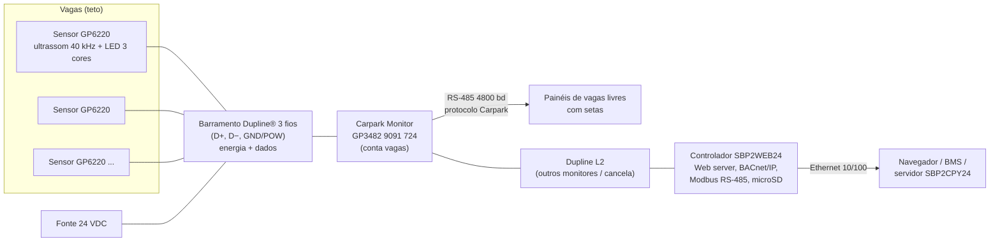
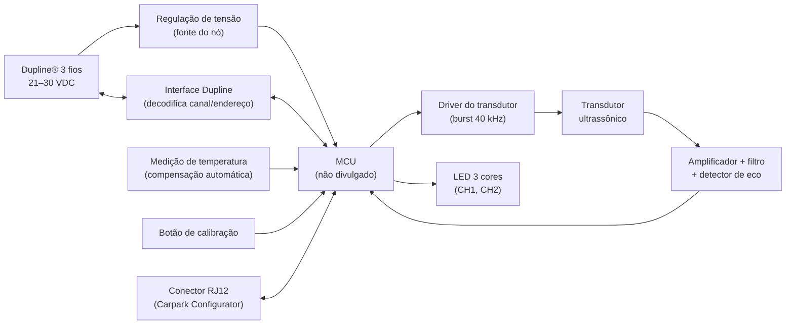
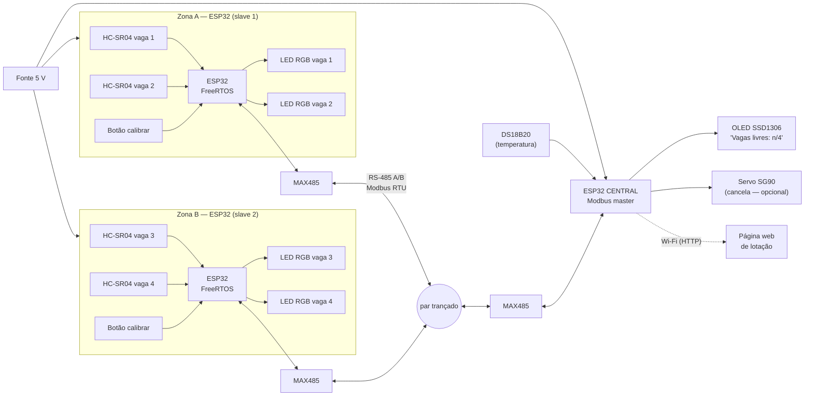

# Trabalho 2 — Sistema de Guiamento de Vagas por Ultrassom (Carlo Gavazzi Dupline® Car Park)

**Disciplina:** Fundamentos de Sistemas Embarcados (FSE) — UnB/FGA — 2026.2

## Integrantes

| Nome completo | Matrícula |
| ------------- | --------- |
| Pedro Luiz Fonseca da Silva | _preencher_ |
| _preencher_ | _preencher_ |
| _preencher_ | _preencher_ |
| _preencher_ | _preencher_ |

---

## Sumário

1. [Descrição do produto selecionado](#1-descrição-do-produto-selecionado)
2. [Análise técnica detalhada](#2-análise-técnica-detalhada-listagem-de-características)
3. [Proposta de reprodução com ESP32](#3-proposta-de-reprodução-com-esp32)
4. [Pesquisa bibliográfica e tecnológica](#4-pesquisa-bibliográfica-e-tecnológica)
5. [Comparativo com produtos similares](#5-comparativo-com-produtos-similares)
6. [Referências](#6-referências)

---

## 1. Descrição do produto selecionado

### 1.1 Visão geral

O produto escolhido é o **sistema de guiamento de vagas (PGS — *Parking Guidance System*) Dupline® Car Park**, da **Carlo Gavazzi Automation**, com foco no seu nó de borda: o **sensor ultrassônico de vaga com indicador de 3 cores GP6220 330x 724-US** [[1]](#ref1). Escolhemos esse produto porque a Carlo Gavazzi publica *datasheets* completos de cada módulo do sistema (sensor, monitor, *master* do barramento, controlador web), o que torna possível documentar a arquitetura com fontes verificáveis — diferente de produtos mais fechados.

O sistema é instalado em **estacionamentos cobertos** (shoppings, aeroportos, hospitais, edifícios comerciais). Cada vaga recebe um sensor fixado no teto que mede, por ultrassom, a distância até o piso: se algo mais alto que um limiar aparece embaixo dele por alguns segundos, a vaga é considerada ocupada. O próprio sensor acende seu LED (ex.: verde = livre, vermelho = ocupada, azul = vaga PNE) e publica seu estado num barramento de 3 fios. Um módulo central agrega os estados e atualiza **painéis de contagem de vagas livres** por andar/setor, com setas que guiam o motorista [[7]](#ref7).

### 1.2 Funções principais, público-alvo e contexto de uso

| Item | Descrição | Fonte |
| ---- | --------- | ----- |
| Função 1 — detecção | Detecta presença de veículo em cada vaga por ultrassom (40 kHz), montado no teto a 1,5–4,0 m do piso | [[1]](#ref1) |
| Função 2 — indicação local | LED de 3 cores integrado mostra o estado da vaga à distância | [[1]](#ref1) |
| Função 3 — contagem e guiamento | Monitores contam vagas livres por zona e alimentam painéis com números e setas | [[4]](#ref4), [[7]](#ref7) |
| Função 4 — gestão | Controlador com servidor web, estatísticas, reserva de vagas, alarmes e integração com BMS (BACnet/IP) | [[6]](#ref6) |
| Função extra | Mesma fiação pode controlar ventilação e iluminação (economia de energia) | [[6]](#ref6), [[7]](#ref7) |
| Público-alvo | Operadores e administradoras de estacionamentos; motoristas são os usuários finais | [[7]](#ref7) |
| Contexto de uso | Ambientes internos/cobertos, temperatura de operação do sensor de −40 °C a 70 °C | [[1]](#ref1) |

### 1.3 Segmento de mercado e aplicações

O produto pertence ao segmento de **sistemas inteligentes de estacionamento (*smart parking*)**, mais especificamente aos **PGIS (*Parking Guidance and Information Systems*)** [[A6]](#a6). Ele é vendido como solução B2B de automação predial. Benefícios declarados pelo fabricante: o motorista encontra vaga mais rápido, há menos circulação de carros (menos emissões e menor necessidade de ventilação) e o operador obtém dados de ocupação [[7]](#ref7).

### 1.4 Fotos, ilustrações e diagramas

> **Fotos do produto:** inserir abaixo as imagens recortadas da primeira página dos *datasheets* (foto do sensor GP6220 e diagrama de ligação). As imagens ficam na pasta `img/` desta mesma pasta.
>
> `` — fonte: [[1]](#ref1)
>
> `` — fonte: [[1]](#ref1)
>
> `` — fonte: [[3]](#ref3)

**Fotos da parte interna / placa:** não encontramos *teardown* público nem registro em órgão de certificação de rádio (FCC/Anatel), já que o produto não possui rádio. Por isso, a placa interna não pôde ser documentada.

> Os três diagramas deste trabalho estão em Mermaid, que o GitLab renderiza direto. Versões em PNG ficam em `img/arquitetura_gavazzi.png`, `img/blocos_no_sensor.png` e `img/proposta_esp32.png`.

**Diagrama da arquitetura do sistema** (elaborado pelo grupo a partir de [[1]](#ref1), [[3]](#ref3), [[4]](#ref4), [[6]](#ref6)):



**Diagrama de blocos interno do nó sensor** (conceitual — os blocos são inferidos das funções descritas no *datasheet* [[1]](#ref1); modelos de chips internos não são divulgados):



### 1.5 Tecnologias de comunicação e controle embarcadas

- **Dupline®**: barramento de campo proprietário da Carlo Gavazzi, de 3 fios, que transporta **alimentação e dados** pelo mesmo cabo, com multiplexação no tempo de até **128 canais** por *master* (tempo de varredura de 132,2 ms para 128 canais). A portadora Dupline é um sinal pulsante de 8,2 V [[5]](#ref5). Cada sensor ocupa 1 endereço de entrada (estado da vaga) e 3 de saída (calibração global, LED CH1, LED CH2) [[1]](#ref1).
- **RS-485**: liga o monitor aos painéis (4800 bd, protocolo "Carpark", até 1200 m) [[4]](#ref4) e é usado pelo controlador web com **Modbus** [[6]](#ref6). O *master* Dupline G3496 oferece **Modbus RTU** (9600 bd, 8 bits, paridade ímpar) para CLP/supervisório [[5]](#ref5).
- **Ethernet + HTTP + BACnet/IP**: no controlador SBP2WEB24 [[6]](#ref6).
- **Controle local**: o sensor decide sozinho o estado da vaga (ultrassom + histerese de ±30 cm + tempo de ativação de 3 s) e tem modo "lane" para contar carros em movimento a até 20 km/h (ativação de 0,4 s) [[1]](#ref1).

---

## 2. Análise técnica detalhada: listagem de características

> Convenção: **N/D** = não divulgado pelo fabricante e não encontrado em *teardown* ou certificação; **N/A** = não se aplica ao produto. Quando o grupo faz uma inferência técnica, ela aparece marcada como *(inferência)* e não conta como dado do fabricante.

### 2.1 Unidade de processamento

| Característica | Descrição no produto | Fonte |
| -------------- | -------------------- | ----- |
| 1.1 Fabricante e modelo do chip | **N/D** no sensor GP6220, no monitor GP3482 e no controlador SBP2WEB24. Os *datasheets* omitem o processador. | [[1]](#ref1), [[4]](#ref4), [[6]](#ref6) |
| 1.2 Arquitetura e núcleos | **N/D**. *(Inferência: a tarefa do nó — gerar burst, cronometrar eco, filtrar e responder no barramento — cabe num MCU de 8/16/32 bits de baixo custo, de núcleo único.)* | — |
| 1.3 Frequência de clock | **N/D** | — |
| 1.4 Co-processadores | **N/D**. Não há indício de DSP ou acelerador. A detecção de eco é feita tipicamente por *front-end* analógico (amplificador + comparador). *(inferência)* | — |

### 2.2 Memória

| Característica | Descrição no produto | Fonte |
| -------------- | -------------------- | ----- |
| 2.1 RAM | **N/D** | — |
| 2.2 Flash/ROM | **N/D** para tipo e capacidade. Existe memória não volátil de programa, pois o sensor guarda firmware e modo de operação. | [[1]](#ref1) |
| 2.3 EEPROM | **N/D** quanto ao chip. O sensor **guarda** endereços Dupline, a distância de calibração e o modo (normal/lane) após ser programado, o que exige memória não volátil (EEPROM ou flash emulando EEPROM). | [[1]](#ref1) |

### 2.3 Sistema operacional

| Característica | Descrição no produto | Fonte |
| -------------- | -------------------- | ----- |
| 3.1 Tipo (sensor) | **N/D**. *(Inferência: firmware **bare-metal**/superloop com interrupções, típico de nós de função única.)* | — |
| 3.1 Tipo (controlador SBP2WEB24) | **N/D**. O controlador tem servidor web, USB host, microSD e BACnet/IP, um conjunto que costuma exigir um RTOS ou Linux embarcado *(inferência)*. | [[6]](#ref6) |
| 3.2 Versão/distribuição | **N/D** | — |

### 2.4 Sensores e atuadores

| Característica | Descrição no produto | Fonte |
| -------------- | -------------------- | ----- |
| 4.1 Sensor principal | **Transdutor ultrassônico de 40 kHz** (emissor/receptor). Instalação a 1,5–4,0 m, histerese ±30 cm, ignora objetos com menos de 30 cm, inclinação máx. ±5°. Fabricante do transdutor **N/D**. | [[1]](#ref1), [[2]](#ref2) |
| 4.1 Compensação de temperatura | "Compensação de temperatura embutida e automática", o que implica um sensor de temperatura interno (modelo **N/D**). | [[1]](#ref1) |
| 4.1 Sensor geração anterior (GP6540 3421) | Ultrassom de 40 kHz, 2,0–3,5 m, cobre vaga de até 4 m × 2,5 m, ignora objetos com menos de 0,8 m | [[3]](#ref3) |
| 4.2 Atuador — LED | LED de **3 cores** integrado (variantes: vermelho/verde/âmbar, vermelho/verde/azul, vermelho/azul/âmbar). A cor é escolhida por 2 bits (CH1, CH2). Pisca vermelho em falha do barramento e verde durante a calibração. | [[1]](#ref1) |
| 4.2 Atuador — LED externo (GP6540) | O modelo anterior não tinha LED e acionava uma unidade de LED externa passiva GP6589 010X por um conector de 5 pinos | [[3]](#ref3) |
| 4.2 Atuadores do sistema | Painéis de vagas livres e setas (via RS-485) e saída para controle de cancela (endereço A7 no Dupline L2) | [[4]](#ref4) |
| 4.3 Conexão com a MCU | Transdutor e LED são internos ao nó (ligação interna **N/D**). Externamente, o nó se comunica pelo barramento Dupline e o sensor de temperatura é interno. | [[1]](#ref1) |

### 2.5 Interfaces de comunicação com fio

| Característica | Descrição no produto | Fonte |
| -------------- | -------------------- | ----- |
| Dupline® 3 fios (sensor) | Energia + dados no mesmo par, conectores *push-wire*, cabo rígido de 1,5 mm² | [[1]](#ref1) |
| Capacidade do barramento | Até 128 canais por *master* (varredura de 132,2 ms). Monitor GP3482: até 120 sensores em L1 e até 480 monitores. SBP2WEB24: até 7 redes Dupline com 90 sensores cada. | [[4]](#ref4), [[5]](#ref5), [[6]](#ref6) |
| Programação | Conector **RJ12** para o *Carpark Configurator* GP7380 0080. O GP6540 usava RJ45 com o programador GAP 1605. | [[1]](#ref1), [[3]](#ref3) |
| RS-485 | Monitor → painéis: 4800 bd, até 1200 m, terminação de 120 Ω selecionável. Controlador web: 2 portas RS-485 com Modbus. | [[4]](#ref4), [[6]](#ref6) |
| Modbus RTU | *Master* Dupline G3496: Modbus RTU, funções 01 e 15, 9600 bd, 8O1, porta RS-232/422/485 isolada | [[5]](#ref5) |
| Ethernet | SBP2WEB24: RJ45 10/100BASE-TX, IP estático ou DHCP | [[6]](#ref6) |
| USB | SBP2WEB24: USB host + mini-USB de serviço | [[6]](#ref6) |
| I2C/SPI/CAN internos | **N/D** | — |

### 2.6 Interfaces de comunicação sem fio

| Característica | Descrição no produto | Fonte |
| -------------- | -------------------- | ----- |
| 6.1 Wi-Fi/BLE/Zigbee/LoRa etc. | **N/A** — o sistema é 100% cabeado. O SBP2WEB24 não lista Wi-Fi. | [[1]](#ref1), [[6]](#ref6) |
| 6.2 Chips de rádio / protocolos | **N/A**. Na camada de aplicação, a rede IP usa **HTTP** (web server) e **BACnet/IP**. | [[6]](#ref6) |

### 2.7 Unidades de entrada/saída (I/O)

| Característica | Descrição no produto | Fonte |
| -------------- | -------------------- | ----- |
| 7.1 GPIO | Pinos internos **N/D**. Logicamente, o GP6220 expõe 1 entrada (estado) e 3 saídas (calibração, LED CH1, LED CH2) no Dupline. O GP6540 tinha 4 canais configuráveis: ocupação, reserva, sincronismo e calibração. | [[1]](#ref1), [[3]](#ref3) |
| 7.2 ADC/DAC | **N/D**. *(Inferência: o eco pode ser detectado por comparador + timer ou por ADC; a temperatura provavelmente é lida por ADC ou por um sensor digital.)* | — |
| 7.3 PWM | **N/D** quanto ao uso de PWM. O burst de 40 kHz do transdutor é, por natureza, um trem de pulsos gerado por timer *(inferência)*. | — |
| Sincronismo entre vizinhos | O GP6540 tem uma saída de **sincronismo** alternada entre sensores vizinhos, que evita que um sensor capte o eco do outro (*crosstalk*) | [[3]](#ref3) |

### 2.8 Fonte de energia e sistema de alimentação

| Característica | Descrição no produto | Fonte |
| -------------- | -------------------- | ----- |
| 8.1 Tipo | Alimentação **pelo próprio barramento** (24 VDC de fonte central). Sensor: 21–30 VDC, 19 mA nominais a 28 V (0,53 W), máx. 20 mA. Controlador: 15–24 VDC, 5 W. | [[1]](#ref1), [[6]](#ref6) |
| 8.2 Gerenciamento (PMIC) | **N/D**. O *master* sincroniza a alimentação DC com a portadora Dupline para compartilhar o GND. | [[5]](#ref5) |
| 8.3 Economia de energia | O sensor não tem modos de *sleep* documentados (alimentação contínua). A economia está no **nível do sistema**: o controle de iluminação e ventilação por ocupação reduz o consumo do estacionamento. | [[6]](#ref6), [[7]](#ref7) |
| 8.4 Backup de energia | **N/D** no sensor. No controlador, "1 s power-off delay" (retenção curta para desligamento ordenado). | [[6]](#ref6) |
| 8.5 Reset / watchdog | **N/D**. O sensor sinaliza falha do Dupline piscando o LED vermelho a cada 1 s. | [[1]](#ref1) |
| 8.6 Supervisor (*brown-out*) | **N/D**. Há proteção contra inversão de polaridade no controlador e proteção contra curto-circuito na portadora do *master*. | [[5]](#ref5), [[6]](#ref6) |

### 2.9 Firmware e atualizações

| Característica | Descrição no produto | Fonte |
| -------------- | -------------------- | ----- |
| 9.1 Firmware | Firmware proprietário que implementa medição, compensação de temperatura, autocalibração (local por botão ou global pelo configurador), modos normal/lane e máquina de estados do LED | [[1]](#ref1) |
| 9.2 OTA | **N/A/N-D** — não há rádio. Os parâmetros são configurados pela porta RJ12. O método de atualização de firmware não é documentado. | [[1]](#ref1), [[6]](#ref6) |

### 2.10 Proteção e segurança

| Característica | Descrição no produto | Fonte |
| -------------- | -------------------- | ----- |
| 10.1 Criptografia por hardware | **N/D** | — |
| 10.2 HSM / Secure Element | **N/D** | — |
| 10.3 Secure boot / flash criptografada | **N/D** | — |
| 10.4 Outras | Segurança por **isolamento físico** (rede cabeada própria, sem rádio). Há isolamento galvânico na porta serial do *master*. Certificação **cULus (UL 60950)**, que trata de segurança elétrica e não de cibersegurança. | [[1]](#ref1), [[5]](#ref5) |

### 2.11 Armazenamento externo

| Característica | Descrição no produto | Fonte |
| -------------- | -------------------- | ----- |
| 11.1 | Sensor: **N/A**. Controlador SBP2WEB24: slot **microSD** (para logs e estatísticas). | [[6]](#ref6) |

### 2.12 Interface com o usuário

| Característica | Descrição no produto | Fonte |
| -------------- | -------------------- | ----- |
| 12.1 Displays | LED de 3 cores por vaga e painéis externos de contagem com setas | [[1]](#ref1), [[7]](#ref7) |
| 12.2 Botões | Botão de calibração local no sensor | [[1]](#ref1) |
| 12.3 Outras | Interface **web** (SBP2WEB24), ferramenta portátil de programação/teste e integração com BMS | [[6]](#ref6), [[7]](#ref7) |

### 2.13 Tecnologias críticas

Sem estas tecnologias o produto não seria viável:

1. **Medição ultrassônica por tempo de voo (ToF) com compensação de temperatura**: é o princípio de detecção. A velocidade do som varia cerca de 0,6 m/s por °C (≈1,75 % a cada 10 °C), então, sem compensação, a distância calibrada "andaria" ao longo do dia [[1]](#ref1), [[A2]](#a2).
2. **Barramento de campo que leva energia e dados num só cabo (Dupline®)**: viabiliza centenas a milhares de nós com fiação simples de teto e sem fonte por sensor [[1]](#ref1), [[5]](#ref5).
3. **Processamento local com histerese e filtragem temporal (3 s)**: evita falsos positivos (pessoas, carrinhos) e mantém o LED funcionando mesmo se a central cair [[1]](#ref1).
4. **Sincronização entre sensores vizinhos**: evita interferência acústica (*crosstalk*) [[3]](#ref3), [[A2]](#a2).
5. **Comunicação mestre-escravo com Modbus RTU sobre RS-485**: integração com painéis, CLPs e supervisórios [[4]](#ref4), [[5]](#ref5).

---

## 3. Proposta de reprodução com ESP32

### 3.1 Objetivo e escopo para o Trabalho Final

Reproduzir **parcialmente** o PGS numa **maquete de estacionamento com 4 vagas**, divididas em **2 zonas** ("setor A" e "setor B") de 2 vagas cada. Cada vaga tem um sensor ultrassônico no "teto" e um LED de status. Uma **central** consulta as zonas, conta as vagas livres, mostra a lotação num display e publica os dados numa página web.

O foco é a arquitetura **central + N controladores em barramento**, que é o coração do produto estudado. No sistema da Carlo Gavazzi, o *Carpark Monitor* agrega até 120 sensores de uma zona e conversa com o resto do sistema por barramento [[4]](#ref4). Na maquete, esse papel fica com o **controlador de zona** (uma ESP32 que lê vários sensores), e por isso **não é preciso uma ESP32 por vaga**.

Escala da maquete: "teto" a ~20–25 cm do piso e carrinhos de brinquedo (≈4–6 cm de altura). O HC-SR04 mede de 2 cm a 4 m [[15]](#ref15), então a diferença piso × carro (~4–6 cm) é bem detectável.

### 3.2 Arquitetura proposta

**3 ESP32 no total:**

| Placa | Papel | Equivalente no produto |
| ----- | ----- | ---------------------- |
| ESP32 Zona A (*slave* Modbus, endereço 1) | Lê 2 HC-SR04, decide o estado de cada vaga, aciona 2 LEDs RGB | Sensores GP6220 + Carpark Monitor da zona [[1]](#ref1), [[4]](#ref4) |
| ESP32 Zona B (*slave* Modbus, endereço 2) | Idem, para as outras 2 vagas | Idem |
| ESP32 Central (*master* Modbus) | Faz *polling* das zonas, soma a lotação, mede temperatura, mostra no OLED, serve a página web e aciona a cancela (opcional) | Controlador SBP2WEB24 + painéis de vagas livres [[6]](#ref6) |

**Enlace entre placas:**

- **Opção A (recomendada) — RS-485 + Modbus RTU**: a central é *master* e as zonas são *slaves*, num par trançado com transceptores MAX485. Reproduz o modelo mestre-escravo cabeado do produto [[9]](#ref9), [[10]](#ref10), [[17]](#ref17).
- **Opção B — ESP-NOW (sem fio)**: as zonas enviam o estado à central por ESP-NOW, um protocolo da Espressif que dispensa roteador [[11]](#ref11). Elimina os MAX485 e a fiação de dados, mas se afasta do produto.
- **Plano de contingência (1 ESP32)**: se faltar placa, uma única ESP32 lê os 4 sensores e faz o papel da central. A detecção e a contagem continuam funcionando, mas a parte de rede deixa de ser demonstrada.



**Mapa de pinos proposto** (ESP32 DevKit V1; os pinos 34–39 são só de entrada e servem bem para o ECHO):

| Função | Controlador de zona | Central |
| ------ | ------------------- | ------- |
| HC-SR04 vaga 1: TRIG / ECHO (via divisor) | GPIO 5 / GPIO 34 | — |
| HC-SR04 vaga 2: TRIG / ECHO (via divisor) | GPIO 18 / GPIO 35 | — |
| LED RGB vaga 1: R / G / B | GPIO 25 / 26 / 27 | — |
| LED RGB vaga 2: R / G / B | GPIO 32 / 33 / 14 | — |
| Botão de calibração (*pull-up* interno) | GPIO 23 | — |
| RS-485: TX / RX / DE+RE do MAX485 | GPIO 17 / 16 / 4 | GPIO 17 / 16 / 4 |
| OLED I2C: SDA / SCL | — | GPIO 21 / 22 |
| DS18B20 (1-Wire, *pull-up* 4,7 kΩ) | — | GPIO 13 |
| Servo SG90 (PWM) | — | GPIO 19 |
| **Total de GPIOs usados** | **14** | **7** |

Cada controlador de zona ainda tem sobra de pinos para 4–6 vagas, e mais ainda se os LEDs RGB forem trocados por LEDs endereçáveis WS2812 (um pino para todos, via periférico RMT).

### 3.3 Mapeamento produto × ESP32

| Característica do produto (seção 2) | Recurso equivalente na ESP32 / ecossistema | Fonte |
| ----------------------------------- | ------------------------------------------ | ----- |
| 1. MCU do sensor/monitor (N/D) | ESP32 (Xtensa LX6 dual-core, até 240 MHz). Uma só ESP32 dá conta de vários sensores, por isso agrupamos 2 vagas por placa. | [[8]](#ref8) |
| 1.4 Co-processador | Co-processador **ULP** (não necessário na maquete) | [[8]](#ref8) |
| 2. Memória e parâmetros não voláteis | 520 KB SRAM e flash SPI externa (4 MB no módulo WROOM-32). Calibração de cada vaga e endereço Modbus gravados em **NVS** (substitui a EEPROM). | [[8]](#ref8) |
| 3. SO (bare-metal no sensor) | **FreeRTOS** do ESP-IDF: tarefas de medição, decisão, comunicação e LED | [[8]](#ref8) |
| 4.1 Transdutor 40 kHz | **HC-SR04** (40 kHz, 2 cm–4 m, ângulo ~15°). Captura do eco por **MCPWM capture**, que tem 6 canais de captura no ESP32 (há exemplo oficial do ESP-IDF). | [[8]](#ref8), [[14]](#ref14), [[15]](#ref15) |
| 4.1 Compensação de temperatura | **DS18B20** (1-Wire) na central, que escreve a temperatura nas zonas por *broadcast* Modbus. Velocidade do som: c = 331,3 + 0,606·T (m/s). | [[A2]](#a2) |
| 4.2 LED de 3 cores | LED RGB catodo comum via **LEDC (PWM)**, ou WS2812 via RMT | [[23]](#ref23) |
| 4.2 Painel de vagas livres | Display **OLED SSD1306 (I2C)** na central | — |
| 4.2 Cancela (A7 no Dupline L2) | **Servo SG90** acionado por PWM (opcional) | — |
| 5. Barramento Dupline | **UART em modo RS-485 half-duplex** + transceptor **MAX485**. A diferença é que **energia e dados vão separados** (fonte 5 V comum). | [[9]](#ref9), [[16]](#ref16) |
| 5. Modbus RTU | Componente **esp-modbus** (*master* na central, *slave* nas zonas) | [[10]](#ref10), [[17]](#ref17) |
| 5. Porta de programação RJ12 | USB-serial da DevKit e/ou comandos Modbus de configuração | [[8]](#ref8) |
| 6. Sem fio (N/A no produto) | Wi-Fi 802.11 b/g/n (página web) e ESP-NOW (Opção B) | [[8]](#ref8), [[11]](#ref11) |
| 7. GPIO/ADC/PWM | 34 GPIOs, ADC SAR 12 bits, LEDC com até 16 canais PWM, MCPWM | [[8]](#ref8) |
| 7. Sincronismo anti-*crosstalk* | Dentro da zona, os sensores disparam **um de cada vez**. Entre zonas, a central define **janelas de tempo** por *broadcast* Modbus para que vagas vizinhas de zonas diferentes não disparem juntas. | [[3]](#ref3), [[A2]](#a2) |
| 8. Alimentação 24 V pelo barramento | Fonte 5 V central (USB ou fonte chaveada) distribuída na maquete | — |
| 8.5/8.6 Watchdog / *brown-out* | *Task Watchdog* e *Interrupt Watchdog* do ESP-IDF e detector de *brown-out* interno | [[8]](#ref8) |
| 9.2 OTA (N/A no produto) | **OTA** do ESP-IDF via Wi-Fi na central (melhoria em relação ao produto) | [[12]](#ref12) |
| 10. Segurança | Aceleradores AES/SHA/RSA/RNG, **Secure Boot v2** e **Flash Encryption** (opcionais) | [[8]](#ref8), [[13]](#ref13) |
| 11. microSD do controlador | Opcional: módulo microSD via SPI na central (log de ocupação) | [[8]](#ref8) |
| 12. Interface web / BMS | Servidor HTTP do ESP-IDF com página de lotação | [[8]](#ref8) |

### 3.4 Firmware conceitual

**Controlador de zona (*slave* Modbus)** — tarefas FreeRTOS:

| Tarefa | Período | Função |
| ------ | ------- | ------ |
| `task_medicao` | ciclo de ~100 ms, dentro da janela liberada pela central | Para cada vaga, **em sequência**: gera *trigger* de 10 µs e mede a largura do eco com MCPWM capture: d = (t × c(T)) / 2 |
| `task_estado` | a cada amostra | Por vaga: filtro de mediana (5 amostras), histerese e confirmação por tempo (3 s, como no produto) |
| `task_led` | evento | Verde = livre, vermelho = ocupada, azul = reservada/PNE, pisca vermelho = sem comunicação com a central |
| `task_modbus` | evento | Atende o *master* (registradores abaixo) |

Mapa de registradores Modbus de cada zona (proposta):

| Endereço | Tipo | Conteúdo |
| -------- | ---- | -------- |
| 30001 | Input register | Número de vagas da zona (2) |
| 30002 / 30003 | Input register | Vaga 1: estado (0 livre, 1 ocupada) / distância filtrada (mm) |
| 30004 / 30005 | Input register | Vaga 2: estado / distância filtrada (mm) |
| 40001 | Holding register | Temperatura enviada pela central (°C × 10) |
| 40002 / 40003 | Holding register | Comando de LED da vaga 1 / vaga 2 (0 automático, 1 reservada, 2 desligado) |
| 40004 | Holding register | Calibração: bit 0 = vaga 1, bit 1 = vaga 2 (com as vagas vazias) |
| 40005 / 40006 | Holding register | Distância de calibração da vaga 1 / vaga 2 (mm), gravada em NVS |
| 40007 | Holding register | Janela de disparo atribuída pela central (anti-*crosstalk*) |

Lógica de decisão por vaga (com *d<sub>cal</sub>* = distância do teto ao piso medida na calibração):

```
se d < d_cal − limiar             por ≥ 3 s → OCUPADA
se d > d_cal − limiar + histerese por ≥ 3 s → LIVRE
```

O LED é decidido **localmente** na zona, então a vaga continua sinalizando mesmo se a central cair, como no produto [[1]](#ref1).

**Central (*master* Modbus)**: `task_poll` lê os registradores 30001–30005 das zonas 1 e 2 (*polling*); `task_contagem` calcula as vagas livres por setor e no total; `task_display` atualiza o OLED ("Livres: A 1/2 · B 2/2 · Total 3/4"); `task_web` serve a página/JSON de lotação; `task_temp` lê o DS18B20 e escreve a temperatura nas zonas por *broadcast*; `task_cancela` (opcional) fecha o servo quando o total chega a 0.

### 3.5 Lista de componentes

> Os itens marcados como **"Lab?"** devem ser conferidos na [Lista de Sensores e Atuadores Disponíveis](/Lista_de_Sensores.md). Os preços são **estimativas** de varejo nacional (nov/2026) e servem só para orçar o que tivermos de comprar.

Maquete com **4 vagas**, **2 controladores de zona** e **1 central**:

| Componente | Qtd. | Função | Origem | Preço unit. estimado |
| ---------- | ---- | ------ | ------ | -------------------- |
| ESP32 DevKit V1 (WROOM-32) | 3 (2 zonas + 1 central) | Processamento | Lab? | R$ 40–55 |
| Sensor ultrassônico HC-SR04 | 4 | Detecção | Lab? | R$ 8–15 |
| LED RGB catodo comum 5 mm + 3 resistores de 220 Ω | 4 | Indicação da vaga | Lab? | R$ 1–3 |
| Módulo MAX485 (TTL ↔ RS-485) | 3 (dispensável na Opção B) | Barramento | Comprar | R$ 6–12 |
| Sensor de temperatura DS18B20 + resistor de 4,7 kΩ | 1 | Compensação | Lab? | R$ 10–20 |
| Display OLED 0,96" SSD1306 I2C | 1 | Painel de vagas livres | Lab? | R$ 20–30 |
| Push-button | 2 (1 por zona) | Calibração local | Lab? | R$ 0,50 |
| Servo SG90 (opcional) | 1 | Cancela | Lab? | R$ 12–20 |
| Divisor resistivo 1 kΩ / 2 kΩ (eco 5 V → 3,3 V) | 4 | Proteção do GPIO | Comprar | R$ 0,20 |
| Fonte 5 V 3 A + protoboards + jumpers + cabo par trançado | 1 kit | Alimentação e ligação | Lab?/Comprar | R$ 40–60 |
| MDF/papelão + carrinhos de brinquedo | — | Maquete | Comprar | R$ 30–50 |

Se nada vier do laboratório, o total estimado fica em **R$ 290–460**. Na prática, o gasto do grupo tende a ser só MAX485, divisores e maquete (≈ R$ 50–90).

**Atenção:** o HC-SR04 é alimentado em 5 V e o pino ECHO devolve 5 V, então é obrigatório usar um divisor resistivo (ou a versão 3,3 V, HC-SR04P/RCWL-1601) antes de ligá-lo à ESP32, cujos GPIOs são de 3,3 V [[8]](#ref8), [[15]](#ref15).

### 3.6 Limitações e desafios esperados

| Aspecto do produto | Situação na reprodução |
| ------------------ | ---------------------- |
| Um sensor inteligente por vaga | **Simplificado**: um controlador de zona atende 2 vagas. Uma falha nessa placa derruba as duas vagas da zona, enquanto no produto só cai uma. |
| Energia e dados no mesmo par (Dupline) | **Não reproduzido**: usaremos RS-485 + fonte separada. Modular energia no barramento exige hardware dedicado. |
| Transdutor industrial, IP34, −40 a 70 °C, 4 m de alcance | **Simplificado**: HC-SR04 de hobby, sem vedação, em maquete de bancada |
| Escala (até 57 600 sensores) | **Simplificado**: 4 vagas em 2 zonas. O Modbus RTU limita a 247 endereços por segmento e o tempo de *polling* cresce com o número de zonas [[17]](#ref17), [[A4]](#a4). |
| *Crosstalk* entre vizinhos | **Desafio**: em maquete os sensores ficam próximos (cone de ~15°); será tratado com disparo sequencial na zona e janelas de tempo entre zonas |
| Reflexões no teto/paredes da maquete e superfícies inclinadas do carrinho | **Desafio**: o eco pode se perder em superfícies anguladas [[A1]](#a1); será tratado com mediana + confirmação por tempo |
| Certificação (UL), robustez industrial | **Fora de escopo** |
| Painéis de LED grandes com setas | **Simplificado**: OLED + página web |

---

## 4. Pesquisa bibliográfica e tecnológica

### 4.1 Artigos sobre as tecnologias que viabilizam o produto

<a id="a1"></a>
**[A1] JEONG, S. H. et al. Low cost design of parallel parking assist system based on an ultrasonic sensor. *International Journal of Automotive Technology*, v. 11, p. 409–416, 2010. DOI: [10.1007/s12239-010-0050-0](https://doi.org/10.1007/s12239-010-0050-0).** — Link: <https://link.springer.com/article/10.1007/s12239-010-0050-0>

*Resumo:* os autores constroem um assistente de estacionamento de baixo custo com apenas dois sensores ultrassônicos, uma ECU e uma IHM, e organizam o software em inicialização, escalonamento, reconhecimento e controle. Contribuem com um algoritmo que reduz o **erro de canto** das medições ultrassônicas, ou seja, o erro do eco que volta de superfícies anguladas.
*Relação com o produto:* mostra que o ultrassom de 40 kHz, com hardware simples e algoritmo leve, basta para detectar a presença de veículos. O erro em bordas e superfícies inclinadas é justamente o que exige a histerese e a filtragem por tempo do GP6220. Para o nosso protótipo, mostra a importância de posicionar o sensor perpendicular ao teto do carrinho.

<a id="a2"></a>
**[A2] ABREU, D.; TOLEDO, J.; CODINA, B.; SUÁREZ, A. Low-Cost Ultrasonic Range Improvements for an Assistive Device. *Sensors*, v. 21, n. 12, art. 4250, 2021. DOI: [10.3390/s21124250](https://doi.org/10.3390/s21124250).** — PDF: <https://www.mdpi.com/1424-8220/21/12/4250/pdf>

*Resumo:* usam o **HC-SR04** (40 kHz, ~4 m, ~15°) num dispositivo para pessoas cegas e mostram que a temperatura do ar altera a velocidade do som o bastante para afetar a medida. O ponto principal é que módulos comuns captam o eco de **outros sensores**. Com pulsos com modulação de fase, os autores reduziram o erro de 7,95 % para 1,01 % no teste de interferência. Também identificam um filtro mal dimensionado no módulo comercial.
*Relação com o produto:* fundamenta duas tecnologias críticas do PGS, a **compensação de temperatura** e a **mitigação de *crosstalk*** entre sensores vizinhos (que o produto resolve por sincronismo). Usa exatamente o sensor que pretendemos usar.

<a id="a3"></a>
**[A3] THOMESSE, J.-P. Fieldbus Technology in Industrial Automation. *Proceedings of the IEEE*, v. 93, n. 6, p. 1073–1101, 2005. DOI: [10.1109/JPROC.2005.849724](https://doi.org/10.1109/JPROC.2005.849724).** — Link: <https://doi.org/10.1109/JPROC.2005.849724>

*Resumo:* apresenta a história dos barramentos de campo desde os anos 1970 (incluindo o Modbus), a padronização (IEC 61158/61784) e uma classificação das técnicas de acesso ao meio: acesso controlado/*polling* mestre-escravo, TDMA e contenção (CSMA). Discute requisitos temporais como período de atualização, *jitter* e tempo de resposta.
*Relação com o produto:* o Dupline® é um barramento de campo com multiplexação no tempo e *master* único, e o Modbus RTU do monitor e do controlador é mestre-escravo. O artigo dá a base teórica para escolher *polling* Modbus na nossa central e para estimar o tempo de varredura de N sensores.

<a id="a4"></a>
**[A4] IBRAHIM, F. A. Implementation of an electronic circuit to study the performance parameters of the MODBUS-RTU protocol and verify its model ability using the OPNET simulation. *Damascus University Journal for Engineering Sciences*, v. 42, n. 3, 2026.** — Link: <https://journal.damascusuniversity.edu.sy/index.php/engj/en/article/view/10983>

*Resumo:* monta um circuito com duas unidades que trocam dados por Modbus RTU, mede o atraso e a taxa de quadros e compara os resultados com a simulação no OPNET. Conclui que o protocolo tem bom desempenho em automação e que o OPNET o modela adequadamente.
*Relação com o produto:* quantifica o custo temporal do Modbus RTU, protocolo usado pelo *master* Dupline e pelo controlador SBP2WEB24 e escolhido para a nossa reprodução. Ajuda a dimensionar o *polling* (quantos nós cabem num ciclo de atualização aceitável do painel).

### 4.2 Artigos sobre aplicação / uso do produto

<a id="a5"></a>
**[A5] LIN, T.; RIVANO, H.; LE MOUËL, F. A Survey of Smart Parking Solutions. *IEEE Transactions on Intelligent Transportation Systems*, v. 18, n. 12, p. 3229–3253, 2017. DOI: [10.1109/TITS.2017.2685143](https://doi.org/10.1109/TITS.2017.2685143).** — PDF aberto (HAL): <https://hal.inria.fr/hal-01501556/document>

*Resumo:* *survey* amplo que organiza as soluções de estacionamento inteligente em coleta de informação (sensores), sistemas de implantação e disseminação de serviços (guiamento, reserva, precificação).
*Relação com o produto:* situa o PGS da Carlo Gavazzi na categoria de sensoriamento fixo por vaga com disseminação local (LED) e por painel, e compara essa abordagem com câmeras, magnetômetros e *crowdsensing*.

<a id="a6"></a>
**[A6] FAHIM, A.; HASAN, M.; CHOWDHURY, M. A. Smart parking systems: comprehensive review based on various aspects. *Heliyon*, v. 7, n. 5, e07050, 2021. DOI: [10.1016/j.heliyon.2021.e07050](https://doi.org/10.1016/j.heliyon.2021.e07050).** — PDF: <https://pmc.ncbi.nlm.nih.gov/articles/PMC8141779/>

*Resumo:* revisão que compara sistemas de estacionamento inteligente por tecnologia, sensores, rede, interface e serviços, com vantagens e desvantagens de cada um. Descreve sensores ultrassônicos (25–50 kHz) como adequados a **ambientes cobertos, montados no teto**, baratos e de baixa manutenção, e lista os PGIS como categoria de serviço.
*Relação com o produto:* justifica a escolha do ultrassom no teto para estacionamentos internos, que é exatamente o caso de uso do GP6220.

<a id="a7"></a>
**[A7] VERA-GÓMEZ, J. A. et al. An Intelligent Parking Management System for Urban Areas. *Sensors*, v. 16, n. 6, art. 931, 2016. DOI: [10.3390/s16060931](https://doi.org/10.3390/s16060931).** — PDF: <https://www.mdpi.com/1424-8220/16/6/931/pdf>

*Resumo:* sistema de baixo custo que conta veículos nas entradas e saídas de zonas com redes de sensores sem fio e envia os dados a um centro que estima a ocupação e orienta motoristas.
*Relação com o produto:* mostra a outra estratégia de contagem (entrada/saída em vez de por vaga), equivalente ao **modo lane** do GP6220. Também mostra a arquitetura nó → central → informação ao motorista, que adotaremos na maquete.

<a id="a8"></a>
**[A8] APPIAH, O.; QUAYSON, E.; OPOKU, E. Ultrasonic sensor based traffic information acquisition system; a cheaper alternative for ITS application in developing countries. *Scientific African*, v. 9, e00487, 2020. DOI: [10.1016/j.sciaf.2020.e00487](https://doi.org/10.1016/j.sciaf.2020.e00487).** — Link: <https://www.sciencedirect.com/science/article/pii/S2468227620302258>

*Resumo:* propõe sensores ultrassônicos **montados acima da via** (*overhead*), um por nó, para estimar congestionamento por **taxa de ocupação**, com custo menor que outras implementações.
*Relação com o produto:* valida a montagem *overhead*, a mesma geometria do sensor de teto do PGS, que reduz a interferência de objetos que não são veículos. Mostra ainda que a métrica de ocupação é suficiente para a tomada de decisão, que é o que a nossa central calculará.

### 4.3 Leituras complementares (não contabilizadas)

- MA, Y. et al. Research Review on Parking Space Detection Method. *Symmetry*, v. 13, n. 1, art. 128, 2021. DOI: [10.3390/sym13010128](https://doi.org/10.3390/sym13010128). Revisão de métodos de detecção de vaga, com prós e contras do ultrassom (feixe largo, baixa resolução, baixo custo).
- MONTEIRO, M. M.; SANTOS JUNIOR, J. C.; SILVA, N. G. Desenvolvimento e análise de um sistema de sonar ativo de baixo custo [...] Arduino. *Revista FT*, v. 30, ed. 154, 2026. DOI: [10.69849/revistaft/cs10202601141310](https://doi.org/10.69849/revistaft/cs10202601141310). HC-SR04 + ToF com Arduino. Os autores sugerem média móvel e Kalman como trabalhos futuros.
- SANTOS, A. M. S. et al. Desenvolvimento de um Medidor Digital Dimensional Automatizado [...] com Arduíno. *XIX INIC/UNIVAP*, 2025 (anais de evento, não periódico). <https://www.inicepg.univap.br/cd/INIC_2025/anais/arquivos/RE_0265_0023_01.pdf>

---

## 5. Comparativo com produtos similares

| Característica | **Gavazzi GP6220 (estudado)** | Gavazzi GP6540 3421 (geração anterior) | Circutor SP3 / BILOGY | i+d3 3PGS-UDLED | Nedap SENSIT | Option Spot-On SPS200 | INDECT UPSOLUT |
| --- | --- | --- | --- | --- | --- | --- | --- |
| Ambiente | Interno, teto | Interno, teto | Interno, teto | Interno, teto | Externo/interno, no piso | Externo, no piso | Interno, câmera |
| Tecnologia de detecção | Ultrassom 40 kHz | Ultrassom 40 kHz | Ultrassom | Ultrassom (máx. 2 m, erro 0,1 m) | Magnético + infravermelho | Magnetômetro 3 eixos + radar 60 GHz | Câmera (LPR) |
| MCU / SO | N/D | N/D | N/D | N/D | N/D | N/D | N/D |
| Comunicação com fio | Dupline® 3 fios | Dupline® 3 fios | RS-485 | RS-485 (até 1000 m) | — | — | N/D |
| Comunicação sem fio | — | — | — | — | Rádio proprietário (protocolo N/D) | LoRaWAN 1.0.3 + NFC | — |
| Alimentação | 21–30 VDC pelo bus, 0,53 W | 24–32 VDC, máx. 10 mA | SP3: 24 VDC, 0,8 W; BILOGY: 24/48 VDC, 1,5 W | N/D | Bateria, > 5 anos | Bateria LiSOCl₂ 3,6 V 8100 mAh, até 10 anos | N/D |
| Indicação local | LED 3 cores integrado | LED externo passivo | SP3: externo; SP3-RG/RB e BILOGY: integrado | LED RGB integrado | — | — | Indicador de vaga (N/D) |
| Compensação de temperatura | Automática | N/D | N/D | N/D | N/A | N/A | N/A |
| Atualização/configuração | RJ12 (configurador) | RJ45 (GAP 1605) | N/D | N/D | N/D | Configuração OTA | Exige manutenção de software |
| Proteção | IP34 | IP61 | N/D | N/D | N/D | IP67 / IK7 | N/D |
| Temperatura de operação | −40 a 70 °C | −25 a 70 °C | SP3: −10 a 50 °C | N/D | N/D | −20 a 60 °C | N/D |
| Fonte | [[1]](#ref1) | [[3]](#ref3) | [[18]](#ref18) | [[19]](#ref19) | [[20]](#ref20) | [[21]](#ref21) | [[22]](#ref22) |

**Análise.** Os sensores de teto para ambientes internos (Gavazzi, Circutor, i+d3) seguem o mesmo padrão: ultrassom + LED + barramento cabeado (Dupline ou RS-485) com alimentação central. A geração anterior da própria Gavazzi (GP6540) usava LED externo, que a geração atual integrou ao sensor. Para áreas externas, o mercado migrou para **sensores de piso a bateria e sem fio** (Nedap, Option), com magnetômetro e radar e LPWAN. Já os sistemas por **câmera** (INDECT UPSOLUT) agregam reconhecimento de placa em troca de mais manutenção. A nossa proposta com ESP32 + RS-485 (controladores de zona + central) replica a família "ultrassom de teto cabeado", e a Opção B (ESP-NOW) aproxima-se da tendência sem fio.

---

## 6. Referências

### Documentação técnica

<a id="ref1"></a>[1] CARLO GAVAZZI. **GP6220 330x 724-US — 3-Colour Ultrasonic Sensor (Dupline® Car Park System)**. Datasheet. Disponível em: <https://www.mouser.com/datasheet/2/1032/gp6220330x_us-1805983.pdf>. Acesso em: 2 nov. 2026.

<a id="ref2"></a>[2] CARLO GAVAZZI. **GP6220 330x-US — 3-Colour Ultrasonic Sensor** (cópia do datasheet distribuída pela RS Components). Disponível em: <https://nonprod.docs.rs-online.com/10f7/0900766b813e1856.pdf>. Acesso em: 2 nov. 2026.

<a id="ref3"></a>[3] CARLO GAVAZZI. **GP 6540 3421 — Dupline® Car Park System, Ultrasonic Sensor**. Datasheet. Disponível em: <https://www.gavazzi.no/wp-content/uploads/GP65403421.pdf>. Acesso em: 2 nov. 2026.

<a id="ref4"></a>[4] CARLO GAVAZZI. **GP34829091724 — Carpark Monitor**. Datasheet. Disponível em: <https://www.mouser.com/datasheet/2/1032/GP34829091724_DS_eng-1805563.pdf>. Acesso em: 2 nov. 2026.

<a id="ref5"></a>[5] CARLO GAVAZZI. **G 3496 0002 — Dupline® Plug & Play Master Module**. Datasheet. Disponível em: <https://www.gavazzi.no/wp-content/uploads/G34960002.pdf>. Acesso em: 2 nov. 2026.

<a id="ref6"></a>[6] CARLO GAVAZZI. **SBP2WEB24 — Carpark Controller**. Datasheet. Disponível em: <https://www.mouser.com/datasheet/2/1032/SBP2WEB24_eng-1806490.pdf>. Acesso em: 2 nov. 2026.

<a id="ref7"></a>[7] CARLO GAVAZZI. **Parking Guidance and Space Availability System**. Folheto. Disponível em: <https://cz.farnell.com/wcsstore/ExtendedSitesCatalogAssetStore/cms/asset/pdf/europe/common/carlo-gavazzi/parkprofcarlogavazzi.pdf>. Acesso em: 2 nov. 2026.

<a id="ref8"></a>[8] ESPRESSIF SYSTEMS. **ESP32 Series Datasheet**. Disponível em: <https://www.espressif.com/sites/default/files/documentation/esp32_datasheet_en.pdf>. Acesso em: 2 nov. 2026.

<a id="ref9"></a>[9] ESPRESSIF SYSTEMS. **ESP-IDF Programming Guide — UART (modo RS-485 half-duplex)**. Disponível em: <https://docs.espressif.com/projects/esp-idf/en/stable/esp32/api-reference/peripherals/uart.html>. Acesso em: 2 nov. 2026.

<a id="ref10"></a>[10] ESPRESSIF SYSTEMS. **esp-modbus** (biblioteca Modbus RTU/TCP para ESP-IDF). Disponível em: <https://github.com/espressif/esp-modbus>. Acesso em: 2 nov. 2026.

<a id="ref11"></a>[11] ESPRESSIF SYSTEMS. **ESP-IDF Programming Guide — ESP-NOW**. Disponível em: <https://docs.espressif.com/projects/esp-idf/en/stable/esp32/api-reference/network/esp_now.html>. Acesso em: 2 nov. 2026.

<a id="ref12"></a>[12] ESPRESSIF SYSTEMS. **ESP-IDF Programming Guide — Over The Air Updates (OTA)**. Disponível em: <https://docs.espressif.com/projects/esp-idf/en/stable/esp32/api-reference/system/ota.html>. Acesso em: 2 nov. 2026.

<a id="ref13"></a>[13] ESPRESSIF SYSTEMS. **ESP-IDF — Secure Boot v2** e **Flash Encryption**. Disponível em: <https://docs.espressif.com/projects/esp-idf/en/stable/esp32/security/secure-boot-v2.html> e <https://docs.espressif.com/projects/esp-idf/en/stable/esp32/security/flash-encryption.html>. Acesso em: 2 nov. 2026.

<a id="ref14"></a>[14] ESPRESSIF SYSTEMS. **Exemplo ESP-IDF: HC-SR04 com MCPWM Capture**. Disponível em: <https://github.com/espressif/esp-idf/tree/master/examples/peripherals/mcpwm/mcpwm_capture_hc_sr04>. Acesso em: 2 nov. 2026.

<a id="ref15"></a>[15] ELECFREAKS. **HC-SR04 Ultrasonic Ranging Module — User's Manual**. Disponível em: <https://cdn.sparkfun.com/datasheets/Sensors/Proximity/HCSR04.pdf>. Acesso em: 2 nov. 2026.

<a id="ref16"></a>[16] ANALOG DEVICES (MAXIM). **MAX1487/MAX481/MAX483/MAX485/MAX487–MAX491 — Low-Power, Slew-Rate-Limited RS-485/RS-422 Transceivers**. Datasheet. Disponível em: <https://www.analog.com/media/en/technical-documentation/data-sheets/MAX1487-MAX491.pdf>. Acesso em: 2 nov. 2026.

<a id="ref17"></a>[17] MODBUS ORGANIZATION. **MODBUS over Serial Line — Specification and Implementation Guide V1.02**. 2006. Disponível em: <https://modbus.org/docs/Modbus_over_serial_line_V1_02.pdf>. Acesso em: 2 nov. 2026.

<a id="ref18"></a>[18] CIRCUTOR. **Parking sensors (SP3, SP3-RG, SP3-RB, BILOGY)**. Disponível em: <https://desarrollo.circutor.com/en/products/parking-guidance/parking-sensors/>. Acesso em: 2 nov. 2026.

<a id="ref19"></a>[19] I+D3. **Parking guidance sensor 3PGS-UDLED**. Disponível em: <https://imasdetres.com/en/parking-guidance-sensor>. Acesso em: 2 nov. 2026.

<a id="ref20"></a>[20] PARKING.NET. **Best known secrets of the wireless parking sensor system SENSIT (Nedap)**. Disponível em: <https://www.parking.net/parking-news/nedap-avi/best-known-secrets-of-the-wireless-parking-sensor-system-sensit>. Acesso em: 2 nov. 2026.

<a id="ref21"></a>[21] OPTION. **Spot-On ParkingSensor SPS200**. Datasheet. Disponível em: <https://www.option.com/wp-content/uploads/2024/09/Option-ParkingSensor-SPS200.pdf>. Acesso em: 2 nov. 2026.

<a id="ref22"></a>[22] PARKING.NET. **INDECT's Ultrasonic Parking Guidance Remains King for Quick Installation and Minimal Maintenance**. 2019. Disponível em: <https://www.parking.net/parking-news/INDECT-USA-Corporation/Ultrasonic-technology-parking-guidance-systems>. Acesso em: 2 nov. 2026.

<a id="ref23"></a>[23] ESPRESSIF SYSTEMS. **ESP-IDF Programming Guide — LED Control (LEDC)**. Disponível em: <https://docs.espressif.com/projects/esp-idf/en/stable/esp32/api-reference/peripherals/ledc.html>. Acesso em: 2 nov. 2026.

### Artigos científicos

Ver as referências completas [A1]–[A8] na [Seção 4](#4-pesquisa-bibliográfica-e-tecnológica).
